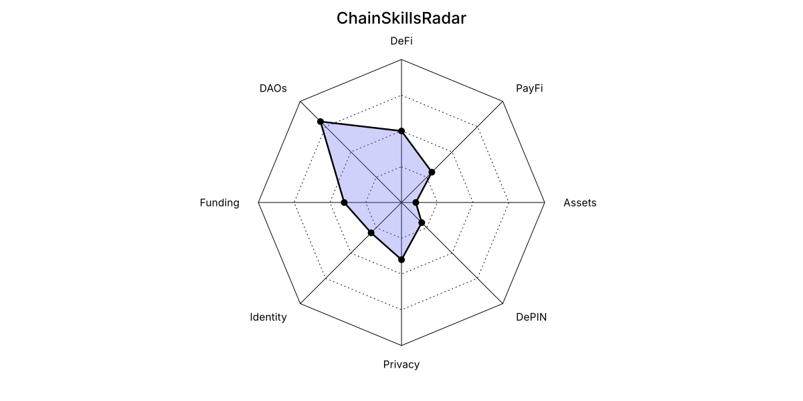

# ChainSkillsRadar

Generate a standalone SVG radar chart for a GitHub README from manually entered scores. No wallet connection, blockchain scanning, or automatic skill assessment is performed. No third-party npm dependencies are required.

## Run locally

Use Node.js 20 or newer. The CI matrix tests Node.js 20, 22, and 24.

```sh
npm test
npm run generate
```

The default command reads `radar.json` and writes `assets/radar.svg`. Add the image to your README:

```md

```

For custom paths and overrides:

```sh
node src/cli.mjs generate --config radar.json --output assets/radar.svg
node src/cli.mjs generate --values '{"DeFi":5,"Privacy":4,"DAOs":8}' --color '#6366f1' --fill-opacity 0 --max 10
node src/cli.mjs --help
```

`--values` replaces all categories, rather than merging them. A missing config is allowed only when `--values` supplies the categories; malformed JSON and non-object existing configs still fail. Every option requires a value. The JSON examples above use POSIX shell quoting.

To install the CLI from a local checkout:

```sh
npm install --global .
chain-skills-radar generate --config radar.json --output assets/radar.svg
```

## Configuration

Create `radar.json`:

```json
{
  "title": "ChainSkillsRadar",
  "max": 10,
  "rings": 4,
  "color": "#6366f1",
  "fillOpacity": 0.3,
  "theme": "auto",
  "width": 1200,
  "height": 600,
  "radius": 214,
  "areas": {
    "DeFi": 5,
    "PayFi": 3,
    "Assets": 1,
    "DePIN": 2,
    "Privacy": 4,
    "Identity": 3,
    "Funding": 4,
    "DAOs": 8
  }
}
```

All fields except `areas` have defaults, shown above. Unknown fields are ignored.

| Field | Accepted values |
| --- | --- |
| `title` | Non-empty string; XML-invalid characters are rejected |
| `areas` | JSON object with 3–16 non-empty category names and numeric scores from 0 to `max` |
| `max` | Finite number greater than 0 |
| `rings` | Integer from 1 to 10 |
| `color` | Three- or six-digit hex color, such as `#abc` or `#6366f1` |
| `fillOpacity` | Number from 0 to 1 |
| `theme` | `auto`, `light`, or `dark` (case-insensitive) |
| `width`, `height` | Safe integers of at least 240; the chart and text must fit |
| `radius` | Positive finite number that fits within the image |

JSON numbers must be numbers, not strings, booleans, or `null`. CLI and Action numeric overrides accept numeric strings and then use the same validation. Categories follow JavaScript object-key order; avoid integer-only names if their order matters.

Each score is converted to a distance of `radius × (score / max)` from the center. The chart has equally spaced axes, polygon grid rings, a filled score polygon, and category labels. Scores are not printed as numbers.

The radius stays fixed when changing image dimensions. If the image is too small, generation fails with a layout error instead of silently clipping the chart. Increase the dimensions, reduce `radius`, or shorten the title and category names. For example, a compact chart can use `title: "Skills"`, `width: 400`, `height: 400`, and `radius: 120` with short labels. Horizontal text validation uses conservative font-width estimates; the exact font depends on the viewer.

`auto` uses the viewer's `prefers-color-scheme` setting. Use `light` or `dark` for a fixed theme. Host pages and image viewers determine whether the media query is applied; a GitHub-specific theme selection is not implemented.

## GitHub automation in this repository

The included `.github/workflows/generate-radar.yml` runs tests on all pushes and pull requests, including changes to tests, package metadata, and workflows. It can also be run manually. Tests run with read-only repository permissions and include a local Action invocation.

After successful tests, pushes or manual runs on the default branch regenerate and commit `assets/radar.svg`. Pull requests, tags, and other branches never run the write job. Generation jobs for the same branch are serialized. The repository must allow Actions to write contents, and branch protection must permit the bot's push; otherwise commit the locally generated SVG through the normal review process.

The JavaScript Action uses Node.js 24, independently of the Node.js selected for CLI tests. Self-hosted runners must support that runtime (runner 2.327.1 or newer). See the [GitHub runtime reference](https://docs.github.com/en/actions/reference/workflows-and-actions/metadata-syntax#runsusing-for-javascript-actions) and [runner requirement](https://github.com/actions/setup-node#breaking-changes-in-v5).

## Use the Action in another repository

You can use the code immediately without a published tag: copy `action.yml`, `action/`, and `src/` into `.github/actions/chain-skills-radar/` in the target repository. Also add `radar.json` at the repository root. Then create this workflow:

```yaml
name: Update ChainSkillsRadar
on:
  workflow_dispatch:
  push:
    branches: [main]
    paths:
      - radar.json
      - .github/actions/chain-skills-radar/**
      - .github/workflows/chain-skills-radar.yml
permissions:
  contents: write
concurrency:
  group: chain-skills-radar-${{ github.ref }}
  cancel-in-progress: false
jobs:
  generate:
    runs-on: ubuntu-latest
    steps:
      - uses: actions/checkout@v7
        with:
          ref: ${{ github.ref_name }}
      - name: Generate radar
        id: radar
        uses: ./.github/actions/chain-skills-radar
        with:
          config: radar.json
          output: assets/radar.svg
      - name: Commit radar
        run: |
          git config user.name "github-actions[bot]"
          git config user.email "41898282+github-actions[bot]@users.noreply.github.com"
          git add assets/radar.svg
          if git diff --cached --quiet; then
            exit 0
          fi
          git commit -m "chore: update skills radar"
          git push origin "HEAD:${GITHUB_REF_NAME}"
```

Change `main` to your default branch if necessary. Run the workflow on that branch. The Action generates the file; the separate commit step saves it to GitHub. The output path is available as `steps.radar.outputs.svg`.

Action inputs are `config`, `output`, `values`, `color`, `fill_opacity`, and `max`. `values` is a JSON object replacing all categories. `fill_opacity` uses an underscore; the JSON config uses `fillOpacity`.

For remote reuse, publish the source in your own GitHub repository and reference its actual owner/repository and an existing commit SHA or release tag in `uses`. No public `v3` tag is assumed by this project. Before publishing a release, run `npm test` and `npm run generate`, commit the result, and create and push the desired release tag. This archive does not publish a repository or a release.
